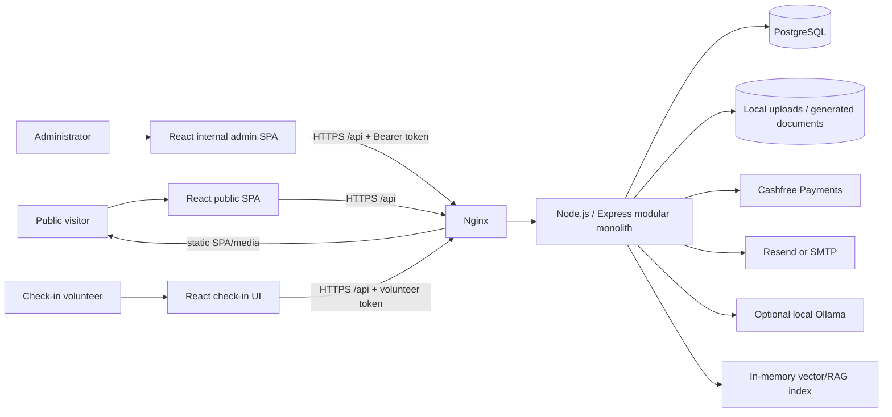
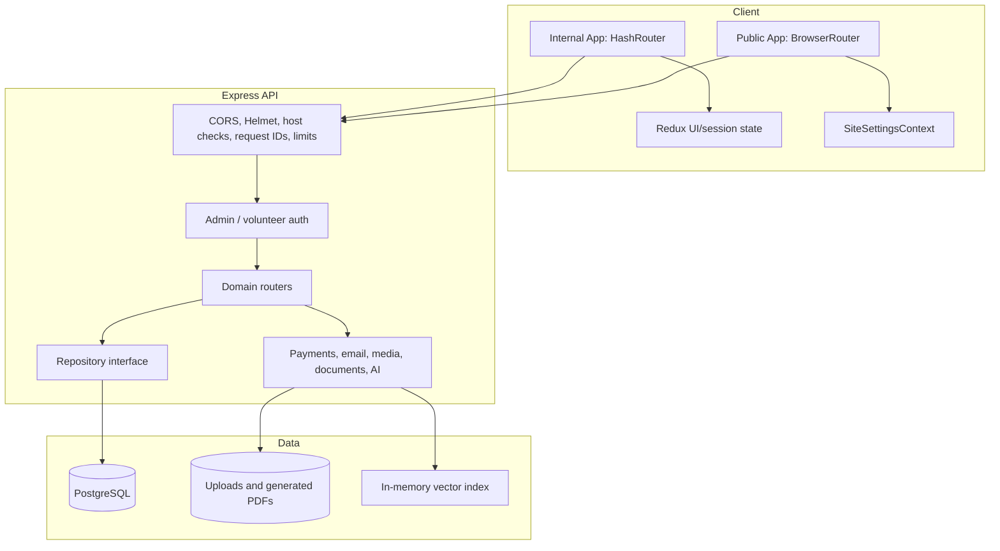
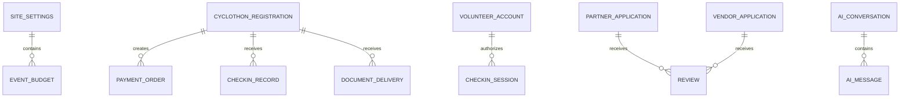
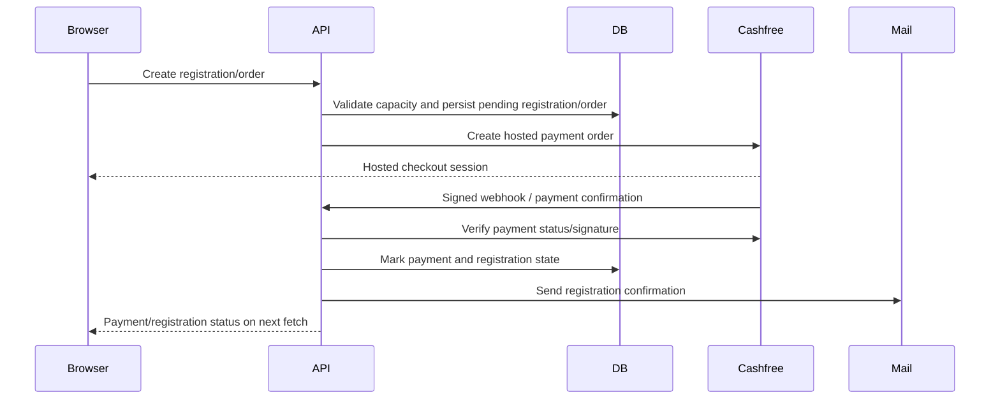
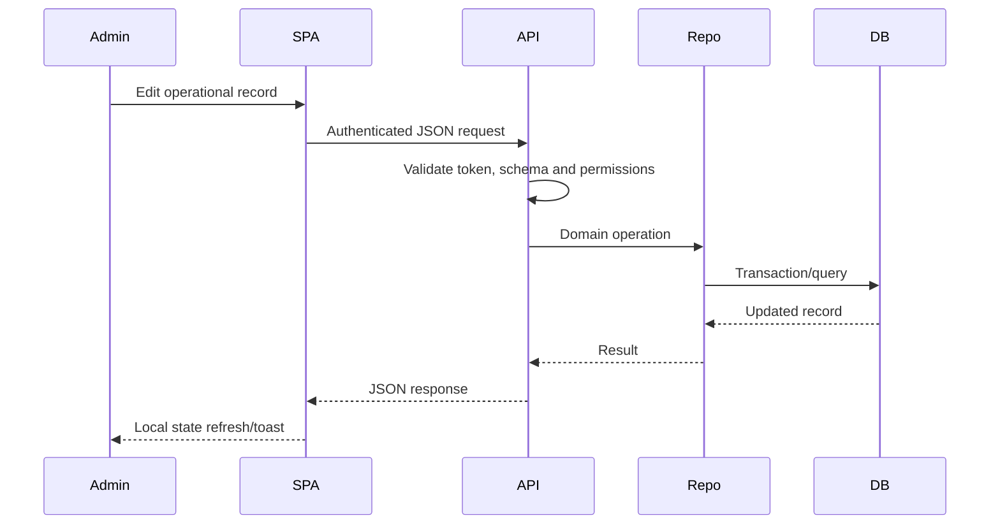
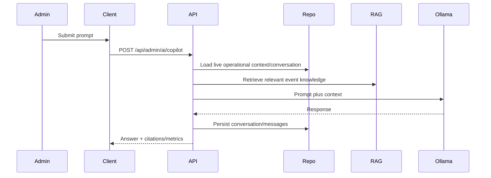
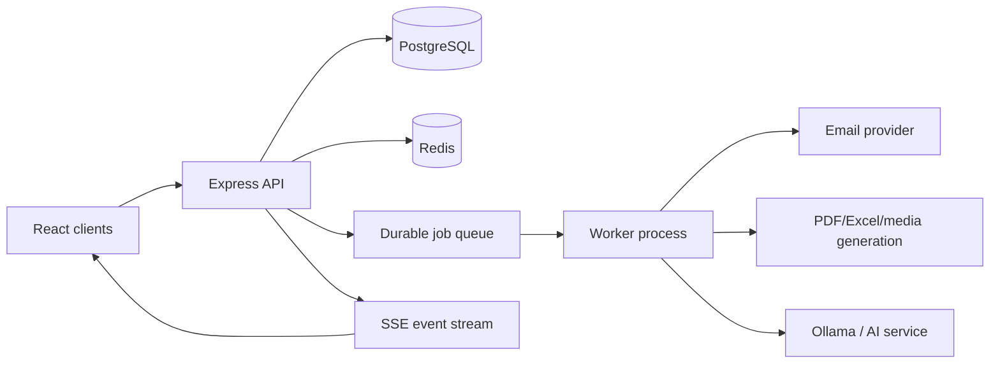

# NV Cyclothon 2026 — Codebase Architecture Analysis

**Scope:** Static architecture review of the React client, Express API, persistence layer, integrations, deployment configuration, and current data-refresh behavior.  
**Reviewed:** 21 October 2026.  
**Method:** Source inspection only; this report does not claim production telemetry, throughput, or database-query measurements.

## 1. Executive summary

NV Cyclothon is a well-featured **modular monolith** for a public cycling-event website and an internal operations console. The browser client is split into public and internal entry points, while a single Express process exposes domain routers. PostgreSQL is the production source of record and an in-memory repository supports tests. The system includes registration/payment initiation and verification, check-in, public content, partner/vendor applications, media processing, participant documents, email, administration, and an optional local Ollama/RAG assistant.

The strongest parts are clear HTTP-route separation, a repository abstraction, server-side validation/security middleware, code-split admin tabs, and a deployment design that keeps PostgreSQL private. The admin workspace now has SSE invalidations with a polling fallback; other browser data still relies largely on request-on-mount/request-on-action. A second concern is that AI/RAG, email, PDF, image processing, and Excel generation are synchronous request-path work, which can delay an API response under load.

## 2. High-level design (HLD)

### System context

### Logical containers

| Container | Technology | Responsibility |
|---|---|---|
| Public web client | React 18, Vite, Tailwind, React Router | Marketing site, registration, partner/vendor forms, gallery/community display. |
| Internal admin client | React 18, Redux Toolkit, HashRouter, lazy tabs | Secure operations workspace, CRUD, analytics, finance, documents, AI copilot. |
| API | Node.js, Express | Auth, validation, business workflows, payment/webhook handling, media/document/email orchestration. |
| Repository layer | PostgreSQL implementation + mock implementation | Central data-access contract; mock is used by tests. |
| PostgreSQL | PostgreSQL 16 | System of record for settings, registrations, payments, operational records and content. |
| File/document layer | Local uploads + Sharp/PDF generation | Sanitized media, rider passes, certificates, generated documents. |
| AI subsystem | Ollama + in-memory vector store | Operations copilot, moderation, drafting, RAG retrieval with local fallback embeddings. |

## 3. Architecture and request flow

### Primary domain boundaries

| Boundary | Main API family | Core entities / responsibilities |
|---|---|---|
| Event registration | `/api/cyclothon` | Registration, category capacity/pricing, payment order lifecycle, passes, certificates. |
| Payments | `/api/orders`, Cashfree service/webhook | Order creation, signature verification, payment state reconciliation. |
| Admin operations | `/api/admin` | Participants, volunteers, delegations, offers, partners, vendors, gallery, settings, finance. |
| Content/community | `/api/content`, `/api/community`, `/api/gallery` | Public settings and curated/public content. |
| Check-in | `/api/checkin` | Volunteer session, QR/manual check-in, active-account checks. |
| Media | `/api/uploads`, `/api/media` | Upload validation/transformation and delivery. |
| AI | `/api/admin/ai` | Copilot, moderation, email drafting, analytics, RAG conversations. |

## 4. Low-level design (LLD)

### 4.1 Client

- `main.jsx` renders the public application with `BrowserRouter`; `internal-main.jsx` renders the admin with `HashRouter`.
- Redux holds admin interaction/session state and feature UI state. Domain data is partly component-owned, partly Redux-managed.
- `client/src/api/http.js` is the common HTTP boundary. It supplies JSON parsing, timeouts, typed `ApiError` values, and Bearer-token helpers.
- `SiteSettingsContext` loads public settings on mount and reloads on focus, visibility return, storage notification, or a custom browser event.
- `AdminPage` lazy-loads major tabs and owns initial analytics/registration loading. Feature tabs load their own detailed data.
- The admin copilot is a docked panel; it calls protected AI APIs and persists conversations server-side.

### 4.2 Server

- `app.js` establishes host/origin policy, security headers, JSON limits, request IDs, route registration, and error normalization.
- Authentication uses signed scoped tokens. Admin sessions now have short-lived access tokens and refresh tokens; volunteer check-in has its own scope.
- Routes parse and validate request payloads through Zod schemas in `services/validation.js`.
- Business services include Cashfree, email, storage/media conversion, certificates, rider-pass PDFs, partner/vendor media, AI/Ollama, RAG, and finance exports.
- `postgresRepository.js` is the production persistence implementation. `mockRepository.js` mirrors the contract for test isolation.

### 4.3 Persistence

The precise physical PostgreSQL schema is initialized by `postgresRepository.js`; the diagram expresses application relationships rather than asserting database foreign-key coverage.

## 5. Key data flows

### 5.1 Registration and payment

### 5.2 Admin data mutation

### 5.3 AI copilot

## 6. Data freshness / lag assessment

This section identifies *potential staleness windows* from code behavior. It does not claim observed production delay.

| Priority | Surface | Current behavior | Likely freshness gap | Impact | Recommendation |
|---|---|---|---|---|---|
| Medium | Admin dashboard and feature tabs | An SSE invalidation stream with polling fallback refreshes root analytics/registrations; feature tabs retain their own fetch state. | Bursty events can coalesce poorly into repeated root reloads, and process-local events do not cross Node instances. | Extra API/database work or stale tab-local detail after scale-out. | Coalesce invalidations by entity, make refresh single-flight, and use Redis/Postgres pub/sub before multi-instance deployment. |
| High | Payment confirmation | Browser generally learns outcome through redirect/status fetch; payment truth is written by server/webhook. | Checkout can appear pending while webhook/verification completes. | Duplicate user retries and support burden. | Poll a status endpoint with backoff after checkout, display “processing,” and expose reconciliation time. |
| Medium | Public site settings | Refreshes on mount/focus/visibility/custom event, not periodic polling. | Already-open public tabs can retain settings until focus/visibility transition. | Event date, registration toggle, or content changes are not immediately public. | Use short cache TTL plus ETag/`If-None-Match`, or an SSE settings-version event. |
| Medium | Finance | Auto-save is debounced; browser data and exported server totals can be separated by the debounce/request interval. | Approximately the debounce period plus network/database time. | Operator can export or navigate before a revision is committed. | Show explicit dirty/saving/confirmed revision timestamps; use optimistic concurrency/versioning on every update. |
| Medium | AI/RAG | RAG index is in-process and initialized lazily; Ollama calls/embedding attempts are synchronous request-path work. | Cold-start indexing and up-to-4-second embedding timeout; AI response time depends on local model load. | Slow copilot/moderation requests and stale knowledge after a deployment/content update. | Pre-warm index, add request metrics/time budgets, move model work to a queue for noninteractive tasks, and version the knowledge base. |
| Medium | Email/PDF/Excel/media | Several generation/send operations occur in HTTP request paths. | Long-running operation holds request open; retry behavior is client-visible. | Timeouts and duplicate-click risk under batch workloads. | Queue heavy work, persist job status, and surface progress/polling endpoints. |
| Low | Multi-instance rate limiting and RAG | Rate limiter and vector index are process-local. | State differs between Node instances. | Inconsistent throttling/search behavior after horizontal scale. | Put rate limiting in Redis and use a shared/vector service or intentional per-instance warm-up. |

## 7. Strengths

- Public and internal applications have deliberate entry points and routing models.
- Admin APIs are protected by scoped Bearer-token middleware; server-side payload validation is broadly used.
- Production configuration guards reject weak secrets and insecure origins.
- Upload handling uses content/type controls and image processing; Nginx can serve immutable media directly.
- PostgreSQL is private to the host in Docker Compose, and Nginx provides TLS, rate limiting, static caching, and reverse proxying.
- The repository abstraction gives tests an isolated mock backend and keeps route code independent of PostgreSQL implementation details.
- API errors use consistent status/code/detail serialization and requests carry an ID for correlation.

## 8. Architecture risks and recommendations

1. **Introduce asynchronous jobs for expensive work.** Rider passes, certificates, bulk email, large imports, Excel export, image processing, and noninteractive AI requests should use a durable queue (for example BullMQ + Redis) with job state stored in PostgreSQL.
2. **Define one freshness strategy.** Use SSE for operational counters/status changes and polling with backoff for payment processing; retain manual refresh as fallback.
3. **Publish a data ownership map.** Settings, budget, registrations, partner/vendor applications, and AI conversations should each document source of truth, update endpoint, cache policy, and invalidation event.
4. **Add observability.** Record request latency by route, PostgreSQL latency, webhook processing duration, queue age, document generation duration, email delivery outcome, and Ollama/RAG duration. Expose health/readiness separately.
5. **Prepare for horizontal scale deliberately.** Externalize rate limits, background jobs, and RAG/index state before adding multiple API processes.
6. **Add contract tests.** Cover payment state transitions, admin refresh-token rotation/failure, idempotent webhooks, document/email jobs, and API schema compatibility between the client and server.

## 9. Suggested target evolution

This preserves the current modular-monolith deployment model while reducing request-path latency and improving data freshness. It does not require an immediate microservices split.

## 10. Verification notes

- The report is based on source code and deployment files present in the workspace.
- Performance statements are hypotheses to validate with route/database/job telemetry.
- Generated `dist` artifacts were not treated as authoritative source; `client/src` and `backend/src` were used for analysis.

## 11. Performance, contention, and deadlock review

### 11.1 Scope and interpretation

This is a static code review of the backend, PostgreSQL repository, AI services, internal/admin client, volunteer check-in client, public client, and deployment-facing real-time path. It identifies **potential** bottlenecks and lock-order risks; it does not claim that a production deadlock or outage has already occurred. No blocked-query, pool-wait, or route-latency telemetry is currently present in the repository to prove frequency or impact.

Severity reflects the likely production consequence during registration peaks or event-day operations. “Deadlock risk” means two transactions can wait cyclically; “contention” means one lock or resource intentionally serializes work. Both require different remediations.

### 11.2 Findings by component

| ID | Severity / type | Exact location and code part | Why it can degrade or block | Recommended remediation |
|---|---|---|---|---|
| DB-01 | Critical — global contention | `backend/src/db/postgresRepository.js:1105-1107`, `createCyclothonRegistration()` → `SELECT pg_advisory_xact_lock(20261018)` | The constant key makes every new registration wait behind every other registration, regardless of ride category or email. It preserves capacity correctness but creates a single-file queue at peak traffic. | Replace it with a category-scoped capacity row lock or a deterministic advisory key per `ride_category`; retain the unique normalized-email index at lines 130-131. Measure lock wait time before/after. Do not remove serialization until an atomic capacity invariant replaces it. |
| DB-02 | High — possible deadlock | `backend/src/db/postgresRepository.js:946-954`, `createOrder()` → multi-product `FOR UPDATE` | Concurrent carts containing the same products in opposite input orders can lock product rows in different orders. `ANY($1)` does not document a lock-acquisition order. | Deduplicate and numeric-sort IDs before querying, and select them with an explicit `ORDER BY id FOR UPDATE`. Add a narrowly scoped retry for PostgreSQL `40P01` and, if needed, `40001`, only around idempotent order creation. |
| DB-03 | High — unbounded waits / poor diagnosis | `backend/src/db/postgresRepository.js:838-850`, `withTransaction()` | Rollback and release are correct, but transactions have no local `lock_timeout`/`statement_timeout`, no SQLSTATE metrics, and no standardized bounded retry. A waiting request can occupy a pool connection until PostgreSQL’s global timeout. | In the transaction helper, use `SET LOCAL lock_timeout` and a route-appropriate `statement_timeout`; log SQLSTATE, elapsed time, and transaction name. Add a tested retry wrapper only for known-safe idempotent units. |
| DB-04 | Medium — table growth/read load | `backend/src/db/postgresRepository.js:2019-2033`, `recordPageVisit()` and `getVisitorAnalytics()` | Each tracked page view inserts a row. The analytics method concurrently runs five aggregates, including whole-table `COUNT`/grouping scans. The existing `created_at` index (line 154) helps the 14-day query but not every aggregate. | Keep raw events for a bounded retention period, aggregate into hourly/daily rollups, cache the dashboard response for 30–60 seconds, and use `EXPLAIN (ANALYZE, BUFFERS)` against production-like volume. |
| DB-05 | Medium — expensive finance read | `backend/src/db/postgresRepository.js:3096-3105`, `getFinanceSummary()` → `SELECT ride_category, payment_status, registration_fee_paise FROM cyclothon_registrations` | Finance reads every registration and calculates totals in Node. It will grow linearly and competes with event-day transaction traffic. | Use SQL aggregates grouped by route/payment state, or maintain a reconciled finance summary. Preserve the current optimistic-update check in `updateEventBudget()` at lines 3107-3112. |
| DB-06 | Medium — cleanup scan and cross-instance overlap | `backend/src/server.js:22-33` and `backend/src/db/postgresRepository.js:3084-3093`, cleanup interval / `cleanupExpiredPendingRegistrations()` | `setInterval` can overlap itself when cleanup is slow; every API instance also runs it. The delete predicate lacks a targeted composite index for pending rows by age. | Use an in-process running guard plus a database advisory/job lock for multi-instance deployment. Add and validate a partial index such as `(created_at) WHERE status='pending' AND payment_status='pending'`; schedule via a durable worker when scaled. |
| DB-07 | Low — correctly bounded hot-row contention | `backend/src/db/postgresRepository.js:1871-1892` and `1895-1915`, check-in `FOR UPDATE` methods | This intentionally serializes duplicate scans for one participant, preventing double check-in. It is not a multi-row deadlock path and the unique check-in-token index exists at lines 711-713. | Keep this design. Ensure the transaction stays limited to read/update/log (as it is now), return the existing “already checked in” response, and load-test repeated scans of the same QR code. |
| API-01 | High — CPU/memory and untracked work | `backend/src/routes/admin.js:575-679`, volunteer bulk upload loop | CSV/XLSX is fully parsed into memory; every row performs sequential bcrypt + database work. Detached credential emails at lines 651-666 have no durable retry, backpressure, or observable result. | Enforce file/row limits; validate then batch/upsert rows; use bounded worker concurrency (not unbounded `Promise.all`); enqueue email delivery in a durable job table/queue and report queued vs delivered separately. |
| API-02 | High — unbounded fan-out | `backend/src/routes/admin.js:1030-1045`, custom certificate send → `Promise.all(eligible.map(...))` | One request can concurrently render/attach/send for every selected rider, exhausting SMTP sockets, memory, CPU, or database connections. | Replace with the existing `mapWithConcurrency()` helper at lines 60-74 immediately; for meaningful batches, enqueue work and return a job ID rather than holding the HTTP request. |
| API-03 | Medium — long synchronous admin actions | `backend/src/routes/admin.js:1080-1092` and `1147-1156`, certificate and rider-pass flows | These are correctly capped at concurrency 5, but still run PDF generation, email, and write operations in the request lifecycle. A timeout/retry can duplicate work without a durable idempotency record. | Retain the cap, then move batch delivery to persisted jobs with a delivery key per registration/document version and a status endpoint. |
| API-04 | Medium — serial network latency | `backend/src/services/email.js:373-388`, `sendEventUpdate()` | Each recipient waits for the previous provider request. A 500-recipient update has 500 round trips on one request path. | Use the provider’s bulk API or a queue with a small configurable worker concurrency; persist recipient-level outcome and retry transient failures. |
| AI-01 | High — database pool fan-out and inconsistent snapshot | `backend/src/services/coPilot.js:9-65`, `buildAdminContext()` → ten-way `Promise.all` plus optional registration search | Every copilot question launches many independent repository reads. Several users can consume the connection pool; results can also represent different database instants. | Build intent-specific context instead of always loading every domain; cache slow-changing settings; add global/per-user concurrency limits. If a coherent answer is required, use a short read-only snapshot transaction or a single aggregate repository query. |
| AI-02 | High — model saturation / tail latency | `backend/src/services/ollama.js:57-106`, `callOllamaChat()` | The 45-second default is a useful upper bound, but no semaphore or queue limits simultaneous local-model calls. Concurrent requests can contend for the same CPU/GPU and all become slow. | Set an explicit bounded model concurrency, reject/queue excess requests with a clear retry response, cap prompt/history and `maxTokens`, and propagate browser disconnect cancellation. Export model queue depth and duration metrics. |
| AI-03 | Medium — cold-start thundering herd | `backend/src/services/vectorStore.js:103-133`, `VectorDatabase.init()` / `search()` | `initialized` is set only after serially embedding all chunks. Concurrent first requests can each initialize the index; each chunk may wait up to four seconds in `getEmbedding()` (lines 76-100). | Store an `initializationPromise` (single-flight), warm the index during application readiness, define a fast fallback, and persist/reuse embeddings when the knowledge version is unchanged. |
| ADMIN-01 | Medium — repeated full refreshes | `client/src/pages/AdminPage.jsx:45-64` and `client/src/features/admin/hooks/useAdminSync.js:25-38, 87-103` | The root `load()` fetches analytics and registrations on initial load and for each SSE event. A burst of updates can start overlapping heavy refreshes; events do not coalesce. | Debounce/coalesce invalidations by entity, ensure only one root refresh is in flight, and let the affected tab refresh only its own resource. Keep the existing lazy tab imports at `AdminPage.jsx:17-22`. |
| ADMIN-02 | Medium — polling is not actually mode-adaptive | `client/src/features/admin/hooks/useAdminSync.js:125-155` | The interval duration is captured when the effect is created. Switching from polling to connected can recreate the SSE connection and interval because `syncStatus` is an effect dependency; it also keeps a 15-second status endpoint request until that transition settles. | Separate connection lifecycle from polling lifecycle; use a stable interval that reads current connection state from a ref, or restart only the timer. Add a single-flight guard to `checkRevisionStatus()` and `performSync()`. |
| ADMIN-03 | Medium — single-process event bus | `backend/src/services/adminEvents.js:3-74` and `backend/src/routes/adminSync.js:47-81` | SSE cleanup is correct, but the `EventEmitter` revision/event state is process-local. Under multiple Node processes, users connected to another instance do not receive invalidations; 200 listeners also becomes an operational ceiling. | For horizontal scale, publish invalidations through Redis/Postgres `LISTEN/NOTIFY` (or a broker), keep SSE as the browser transport, and expose connection/subscriber metrics. |
| CHECKIN-01 | Medium — camera CPU/battery pressure | `client/src/pages/CheckinPage.jsx:343-362`, `detectQrFrame()` | Barcode detection runs again on every animation frame, potentially 60 scans/sec while the camera is open. On lower-end event devices this can make the scanner and UI sluggish. | Throttle detection to roughly 6–10 FPS, skip when the document is hidden or a request is busy, and measure scan success/CPU on the actual volunteer device class. |
| CHECKIN-02 | Low — per-request authorization query | `backend/src/services/security.js:142-165`, `requireVolunteer()` | Every authenticated check-in request verifies the volunteer account against the repository. This is a defensible immediate-revocation tradeoff, but it adds database load during search/scan peaks. | Capacity-test it first. If needed, cache active-account status for a short TTL or use a session-version claim with explicit revocation; do not sacrifice rapid volunteer deactivation without an alternative. |
| CHECKIN-03 | Low — positive controls | `client/src/pages/CheckinPage.jsx:299-341` and `403-457` | The scan submit ref prevents duplicate submit; search cancels its previous request. The server methods in DB-07 use row locks and a unique token index. | Keep these safeguards. Add an event-day test that fires duplicate QR/manual requests concurrently and asserts exactly one log entry/first-check-in result. |
| PUBLIC-01 | Medium — visit write amplification | `client/src/App.jsx:102-106` and `backend/src/db/postgresRepository.js:2019-2020` | One new session-path creates a database write. `sessionStorage` limits repeat navigation in a tab, but bots and many unique visitors still directly increase database write volume. | Use client-side batching/sampling for nonessential analytics, rate-limit/dedupe server-side, and send to an append/analytics pipeline or aggregate table rather than the transactional database hot path. |
| PUBLIC-02 | Low — duplicate reads and stale overwrites | `client/src/state/SiteSettingsContext.jsx:99-151`, `loadSettings()` plus focus/visibility/storage listeners | Simultaneous triggers can issue several settings requests. A slower earlier response can overwrite a newer one; unnecessary reads accumulate across public tabs. | Track a monotonic request ID or use an `AbortController`, coalesce concurrent requests, and add ETag/`If-None-Match` support with a short TTL. |
| FRONTEND-01 | Low — cancellation is reported as timeout | `client/src/api/http.js:35-84`, `request()` | A caller-supplied `AbortSignal` is passed through, but every `AbortError` becomes `ApiError(408)`. Check-in currently also checks `controller.signal.aborted`, so it avoids a visible error, but other callers cannot distinguish intentional cancellation from timeout. | Preserve a caller-cancelled `AbortError` (or use a distinct `ERR_ABORTED`) and only map the helper’s own timeout to `ERR_TIMEOUT`. This improves retry behaviour and telemetry accuracy. |
| PLATFORM-01 | High at current scale — process-local state | `deploy/ecosystem.config.js:9-16` configures two PM2 cluster workers; `backend/src/services/adminEvents.js:73-74`, `backend/src/services/vectorStore.js:103-126`, and `backend/src/server.js:22-33` keep event, RAG, and cleanup state in each worker. | The deployed topology already has more than one process. Each one has a different SSE revision/index and schedules cleanup independently; this makes ADMIN-03 and DB-06 current operational concerns, not merely future-scale concerns. | Use a shared event/job coordinator now (Redis or PostgreSQL advisory lock plus pub/sub). Keep RAG warm-up local only if it is bounded and intentional; otherwise persist/reuse the index. |

### 11.3 Deadlock posture and lock-order policy

The only concrete multi-row lock-order risk found is **DB-02**. The global registration advisory lock in **DB-01** is contention rather than a cyclic deadlock, and the payment/check-in row locks are single-record serialization that should remain. The repository’s `try/catch/finally` transaction wrapper correctly rolls back and releases a client (`postgresRepository.js:838-850`), which prevents leaked connections after failure.

Adopt this policy before changing transactional code:

1. Acquire rows of the same entity type in one canonical order (normally ascending primary key).
2. Never call email, payment providers, Ollama, file/PDF generation, or other network services while a PostgreSQL transaction/row lock is open.
3. Use short `lock_timeout` and `statement_timeout` values suited to each endpoint; return a retryable conflict rather than allowing connection-pool starvation.
4. Retry only `40P01`/`40001` for idempotent operations, with small jitter and a bounded attempt count. Record the idempotency key before retrying externally visible work.
5. Monitor `pg_stat_activity`, `pg_locks`, slow query counts, pool wait time, API p95/p99, and AI/job queue depth. Alert on lock waits and not only HTTP failures.

### 11.4 Delivery order

1. **Protect peak registration and orders:** DB-01, DB-02, DB-03, DB-06; add query/lock telemetry and a concurrent-registration test first.
2. **Remove request-path fan-out:** API-01 through API-04, then introduce the durable job/outbox model described in section 9.
3. **Bound AI and live refresh work:** AI-01 through AI-03 and ADMIN-01 through ADMIN-03.
4. **Prepare event-day devices and public traffic:** CHECKIN-01, PUBLIC-01, PUBLIC-02, and FRONTEND-01.

### 11.5 Validation checklist

- Run a load test with simultaneous registrations across categories and opposite-order product carts; assert no duplicate registration/order inventory and capture `40P01`, `40001`, lock wait, and p95 latency.
- Run `EXPLAIN (ANALYZE, BUFFERS)` for the registration cleanup, visitor analytics, and finance summary queries at representative data sizes before and after indexing/aggregation.
- Test an import and certificate/email batch larger than the expected event volume; assert a bounded worker count, resumability, exact recipient outcome, and no duplicate send after retry.
- Simulate five concurrent copilot prompts plus a cold vector index; assert one initialization, a bounded number of Ollama calls, and a graceful overload response.
- On target mobile/volunteer hardware, keep the scanner open for ten minutes and record frame rate, CPU/thermal behaviour, scan-to-confirmation time, and duplicate-scan correctness.
